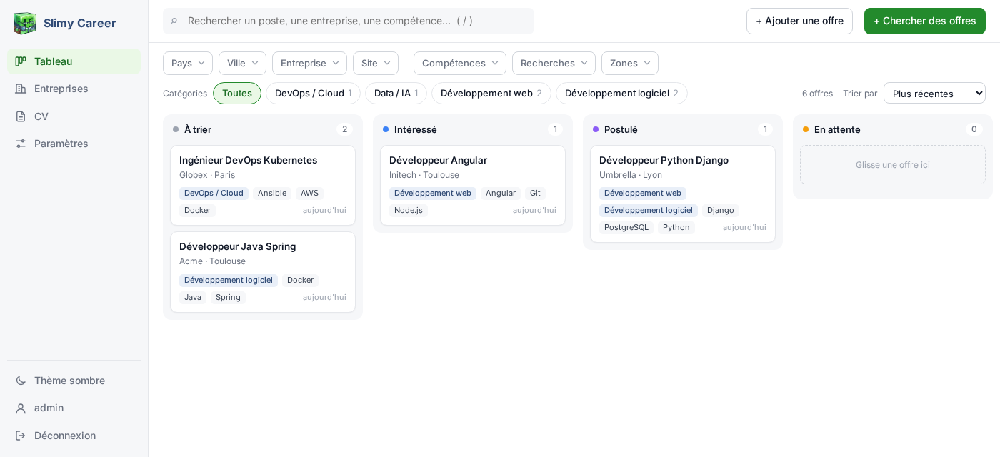

  

<h1 align="center">Slimy Career</h1>

  L'application qui t'aide à trouver un travail : elle cherche les offres à ta place, 
  t'aide à suivre tes candidatures et à préparer un CV pour chacune.

Thème sombre

## À quoi ça sert

Chercher un emploi, c'est refaire chaque jour les mêmes recherches sur plusieurs sites, perdre le fil de ce qu'on a
déjà vu, et adapter son CV à chaque annonce. Slimy Career regroupe tout cela au même endroit :

- **les offres** de plusieurs sites, réunies et sans doublon ;
- **un tableau de suivi** pour savoir où en est chaque candidature ;
- **un éditeur de CV**, avec un PDF que les logiciels de recrutement savent lire.

L'application s'installe chez soi et se partage entre proches : chacun a son compte, avec son propre tableau, ses
CV et ses réglages.

## Comment ça marche

1. **Tu décris ce que tu cherches.** Dans les paramètres : les métiers ou mots-clés, le type de contrat, les villes
   ou régions, et les sites à consulter.
2. **L'application cherche pour toi.** Un clic sur « Chercher des offres » lance toutes les recherches. Les offres
   trouvées arrivent dans la colonne « À trier », avec leur description, l'entreprise, le lieu et les compétences
   demandées. Relancer une recherche n'efface rien : seules les nouvelles offres s'ajoutent.
3. **Tu tries.** Tu fais glisser chaque offre d'une colonne à l'autre : À trier, Intéressé, Postulé, En attente,
   Entretien, Refusé, Pas intéressé. Des filtres (ville, entreprise, compétences, mots-clés…) aident à s'y
   retrouver, et tu peux ajouter des notes sur chaque offre.
4. **Tu prépares ton CV.** L'éditeur montre le résultat en direct. Tu peux importer un CV existant, choisir un
   style, corriger les fautes, le traduire en anglais, et l'adapter à une offre du tableau : l'application indique
   les compétences de l'annonce qui manquent dans ton CV.
5. **Tu postules et tu suis.** Le lien de chaque offre renvoie vers l'annonce d'origine, où tu postules toi-même.
   Le tableau garde la trace de la suite, et la page « Entreprises » résume tes candidatures par entreprise.

Une offre trouvée ailleurs (bouche-à-oreille, site d'une entreprise) s'ajoute à la main avec « Ajouter une offre ».

## D'où viennent les offres

| Site | Ce que l'application y consulte |
|---|---|
| **LinkedIn** | les annonces publiques, visibles sans être connecté |
| **HelloWork** | les résultats de recherche et le détail de chaque annonce |
| **Indeed** | les résultats de recherche |
| **Google Jobs** | les annonces regroupées par Google (facultatif, demande une clé gratuite) |

À savoir :

- L'application ne lit que des **annonces publiques**. Elle n'a pas besoin de tes comptes sur ces sites et ne s'y
  connecte jamais à ta place.
- Elle **ne postule pas pour toi** et ne contacte aucun recruteur.
- Les recherches partent de la machine où l'application est installée, à ta demande uniquement.
- Ces sites peuvent changer ou limiter les consultations : il arrive qu'un site ne renvoie rien pendant un moment.

## Tes données

Offres, notes et CV sont enregistrés sur la machine où l'application est installée, pas chez un prestataire.
Chaque compte est protégé par un mot de passe et, si tu l'actives, par une double authentification.

Deux fonctions facultatives envoient du texte à un service extérieur, uniquement quand tu les utilises :
le **correcteur** (LanguageTool) et la **traduction** du CV (DeepL, avec ta propre clé).

Tu peux télécharger une sauvegarde complète de ton compte à tout moment, dans « Mon compte ».

## Installer et aller plus loin

| Document | Contenu |
|---|---|
| [Déploiement](docs/deploiement.md) | installer l'application et la rendre accessible depuis Internet |
| [Développement](docs/developpement.md) | lancer l'application sur son poste pour la modifier |
| [Détails techniques](docs/technique.md) | technologies, architecture, sécurité |
| [Base de données](docs/base-de-donnees.md) | carte des tables |

## Licence

Slimy Career est publié sous licence [PolyForm Noncommercial 1.0.0](LICENSE.md) : chacun peut le lire, l'utiliser,
le modifier et le partager **à des fins non commerciales**, en conservant la licence et la mention de l'auteur.
Tout usage commercial (vente du logiciel, d'un dérivé ou d'un service payant bâti dessus) est interdit sans
l'accord écrit de l'auteur.
