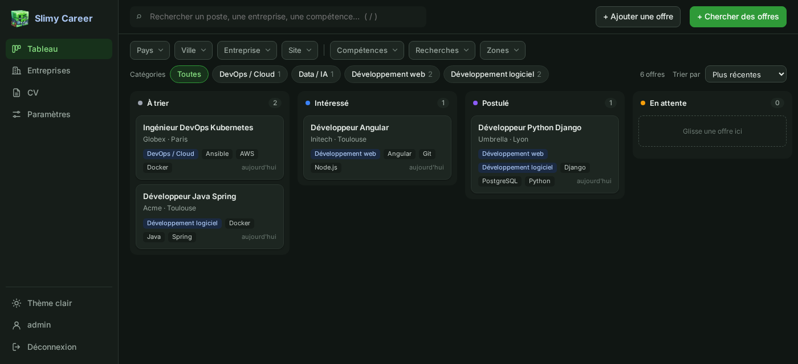

  

<h1 align="center">Slimy Career</h1>

<b>English</b> · <a href="README.fr.md">Français</a>

  The app that helps you find a job: it searches for job offers on your behalf, 
  helps you track your applications and prepare a résumé for each one.

Dark theme

The interface is in French.

## What it is for

Looking for a job means running the same searches on several sites every day, losing track of what you have
already seen, and adapting your résumé to each posting. Slimy Career brings all of this together:

- **job offers** from several sites, gathered in one place without duplicates;
- **a tracking board** to know where each application stands;
- **a résumé editor**, producing a PDF that recruiting software can read.

The app is self-hosted and can be shared with people close to you: everyone has their own account, with their own
board, résumés and settings.

## How it works

1. **You describe what you are looking for.** In the settings: jobs or keywords, contract type, cities or regions,
   and the sites to search.
2. **The app searches for you.** One click on "Chercher des offres" (Search for offers) runs every search. The
   offers found land in the "À trier" (To sort) column, with their description, company, location and required
   skills. Running a search again erases nothing: only new offers are added.
3. **You sort.** Drag each offer from one column to the next: To sort, Interested, Applied, Waiting, Interview,
   Rejected, Not interested. Filters (city, company, skills, keywords…) help you find your way, and you can add
   notes to each offer.
4. **You prepare your résumé.** The editor shows the result live. You can import an existing résumé, pick a style,
   fix spelling mistakes, translate it into English, and tailor it to an offer from the board: the app points out
   the skills from the posting that are missing from your résumé.
5. **You apply and follow up.** Each offer links back to the original posting, where you apply yourself. The board
   keeps track of what happens next, and the "Entreprises" (Companies) page sums up your applications per company.

An offer found elsewhere (word of mouth, a company website) can be added by hand with "Ajouter une offre".

## Where the offers come from

| Site | What the app reads there |
|---|---|
| **LinkedIn** | public postings, visible without being logged in |
| **HelloWork** | search results and the details of each posting |
| **Indeed** | search results |
| **Google Jobs** | postings aggregated by Google (optional, requires a free key) |

Good to know:

- The app only reads **public postings**. It does not need your accounts on these sites and never logs in on your
  behalf.
- It **does not apply for you** and does not contact any recruiter.
- Searches are sent from the machine where the app is installed, and only when you ask for them.
- These sites may change or limit access: a site can return nothing for a while.

## Your data

Offers, notes and résumés are stored on the machine where the app is installed, not with a third-party provider.
Each account is protected by a password and, if you enable it, by two-factor authentication.

Two optional features send text to an external service, only when you use them: the **spell checker**
(LanguageTool) and the résumé **translation** (DeepL, with your own key).

You can download a full backup of your account at any time, from "Mon compte" (My account).

## Install and go further

| Document | Content |
|---|---|
| [Deployment](docs/deployment.md) | install the app and make it reachable from the Internet |
| [Development](docs/development.md) | run the app on your machine to modify it |
| [Technical details](docs/technical.md) | technologies, architecture, security |
| [Database](docs/database.md) | map of the tables |

## License

Slimy Career is released under the [PolyForm Noncommercial 1.0.0](LICENSE.md) license: anyone may read, use, modify
and share it **for noncommercial purposes**, keeping the license and the author notice. Any commercial use (selling
the software, a derivative, or a paid service built on it) is forbidden without the author's written permission.
