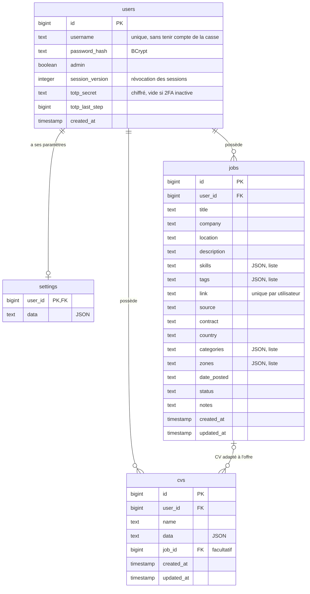

# Carte de la base de données

Base PostgreSQL 17. Le schéma est créé par Flyway à partir de
`backend/src/main/resources/db/migration/` (`V1__init.sql`, `V2__securite_comptes.sql`).

Tout est rattaché à un utilisateur : supprimer un compte supprime ses offres, ses CV et ses paramètres.

## Schéma

## Relations

| De | Vers | Cardinalité | À la suppression |
|---|---|---|---|
| `settings.user_id` | `users.id` | 0 ou 1 ligne par utilisateur | les paramètres sont supprimés avec le compte |
| `jobs.user_id` | `users.id` | plusieurs offres par utilisateur | les offres sont supprimées avec le compte |
| `cvs.user_id` | `users.id` | plusieurs CV par utilisateur | les CV sont supprimés avec le compte |
| `cvs.job_id` | `jobs.id` | un CV peut être lié à une offre | le CV est conservé, le lien est vidé |

## Tables

### `users` : comptes

| Colonne | Type | Contrainte | Rôle |
|---|---|---|---|
| `id` | `bigint` | clé primaire, auto-générée | identifiant du compte |
| `username` | `text` | obligatoire, unique sans tenir compte de la casse | identifiant de connexion |
| `password_hash` | `text` | obligatoire | mot de passe haché (BCrypt), jamais en clair |
| `admin` | `boolean` | défaut `false` | peut créer et supprimer des comptes |
| `session_version` | `integer` | défaut `0` | augmente au changement de mot de passe ou de double authentification ; une session ouverte avec une ancienne valeur est refusée |
| `totp_secret` | `text` | | secret de la double authentification, chiffré (AES-GCM, clé `APP_SECRET_KEY`) ; vide si elle est désactivée |
| `totp_last_step` | `bigint` | défaut `0` | dernier code accepté, pour qu'un code ne serve pas deux fois |
| `created_at` | `timestamp` | défaut : maintenant | date de création |

### `settings` : paramètres de recherche d'un utilisateur

| Colonne | Type | Contrainte | Rôle |
|---|---|---|---|
| `user_id` | `bigint` | clé primaire, référence `users.id` | propriétaire |
| `data` | `text` | obligatoire | JSON des paramètres |

La ligne n'existe qu'après le premier enregistrement des paramètres. Les valeurs absentes viennent de
`backend/src/main/resources/default-settings.json`.

Contenu de `data` :

| Clé | Type | Rôle |
|---|---|---|
| `locations` | liste | villes, régions ou pays où chercher |
| `country` | texte | pays des recherches et pays par défaut des offres |
| `radius_km` | entier | rayon autour d'une ville |
| `results_per_search` | entier | résultats par site, par recherche et par zone |
| `max_age_days` | entier | âge maximal des offres |
| `parallel_searches` | entier | recherches lancées en même temps |
| `per_site` | entier | recherches simultanées sur un même site |
| `searches` | liste | recherches complètes, envoyées telles quelles |
| `contract` | texte | type de contrat ajouté devant les tags et compétences |
| `search_tags` | liste | domaines cherchés séparément |
| `search_skills` | liste | compétences cherchées séparément |
| `sites` | liste | sites activés (`linkedin`, `hellowork`, `indeed`, `google`) |
| `skills` | liste | compétences à détecter dans les offres |
| `categories` | objet | nom de catégorie → mots-clés |
| `serpapi_key` | texte | clé SerpAPI propre à l'utilisateur (facultative) ; chiffrée (`enc:…`), jamais renvoyée au navigateur |
| `deepl_key` | texte | clé DeepL de l'utilisateur ; chiffrée (`enc:…`), jamais renvoyée au navigateur |

### `jobs` : offres

| Colonne | Type | Contrainte | Rôle |
|---|---|---|---|
| `id` | `bigint` | clé primaire, auto-générée | identifiant de l'offre |
| `user_id` | `bigint` | obligatoire, référence `users.id` | propriétaire |
| `title` | `text` | obligatoire | intitulé du poste |
| `company` | `text` | | entreprise |
| `location` | `text` | | lieu tel que donné par le site |
| `description` | `text` | | texte de l'offre |
| `skills` | `text` | défaut `[]` | JSON : compétences détectées ou ajoutées à la main |
| `tags` | `text` | défaut `[]` | JSON : recherches qui ont trouvé l'offre |
| `link` | `text` | obligatoire, unique par utilisateur | lien de l'offre ; `manuel:…` pour une offre saisie sans lien |
| `source` | `text` | | site d'origine, ou `manuel` |
| `contract` | `text` | | type de contrat |
| `country` | `text` | | pays déduit du lieu |
| `categories` | `text` | défaut `[]` | JSON : catégories automatiques |
| `zones` | `text` | défaut `[]` | JSON : zones de recherche qui ont trouvé l'offre |
| `date_posted` | `text` | | date de publication donnée par le site |
| `status` | `text` | défaut `a_trier` | colonne du tableau |
| `notes` | `text` | défaut vide | notes de l'utilisateur |
| `created_at` | `timestamp` | défaut : maintenant | date d'ajout |
| `updated_at` | `timestamp` | défaut : maintenant | dernière modification |

Valeurs de `status` : `a_trier`, `interesse`, `postule`, `en_attente`, `entretien`, `refuse`, `pas_interesse`.

La contrainte d'unicité `(user_id, link)` sert au dédoublonnage : une offre retrouvée par une nouvelle
recherche garde son statut et ses notes, seuls ses tags et zones sont complétés. Deux utilisateurs peuvent
avoir la même offre, chacun avec son propre statut.

### `cvs` : CV

| Colonne | Type | Contrainte | Rôle |
|---|---|---|---|
| `id` | `bigint` | clé primaire, auto-générée | identifiant du CV |
| `user_id` | `bigint` | obligatoire, référence `users.id` | propriétaire |
| `name` | `text` | obligatoire | nom du CV dans l'éditeur |
| `data` | `text` | défaut `{}` | JSON : tout le contenu du CV |
| `job_id` | `bigint` | référence `jobs.id` | offre pour laquelle le CV a été adapté |
| `created_at` | `timestamp` | défaut : maintenant | date de création |
| `updated_at` | `timestamp` | défaut : maintenant | dernière modification |

Contenu de `data` :

| Clé | Type | Rôle |
|---|---|---|
| `lang`, `lang_variant` | texte | langue du CV (`fr` ou `en`, variante `en-GB` / `en-US`) |
| `style` | texte | `moderne`, `tech` ou `classique` |
| `accent` | texte | couleur (`#rrggbb`) |
| `max_pages` | entier | 1 ou 2 |
| `show_photo`, `photo` | booléen, texte | photo en image encodée (data URI) |
| `section_order` | liste | ordre des sections |
| `info` | objet | prénom, nom, titre, e-mail, téléphone, ville, liens, disponibilité, profil |
| `experience` | liste d'objets | intitulé, entreprise, lieu, début, fin, en cours, description |
| `projects` | liste d'objets | nom, contexte, technologies, lien, dates, description |
| `education` | liste d'objets | diplôme, école, lieu, dates, description |
| `certifications` | liste d'objets | nom, organisme, date |
| `hard_skills` | liste d'objets | catégorie et liste de compétences |
| `soft_skills`, `interests` | listes | textes courts |
| `languages` | liste d'objets | langue et niveau |

## Index

| Index | Table | Colonnes | Sert à |
|---|---|---|---|
| `users_username_key` | `users` | `lower(username)`, unique | connexion et unicité des identifiants |
| contrainte unique | `jobs` | `(user_id, link)` | dédoublonnage des offres |
| `jobs_user_status_idx` | `jobs` | `(user_id, status)` | chargement du tableau d'un utilisateur |
| `cvs_user_idx` | `cvs` | `user_id` | liste des CV d'un utilisateur |

## Choix de conception

- **JSON stocké en `text`** : les listes et objets (compétences, catégories, contenu du CV) sont lus et écrits
  en entier par l'application, et le type `text` conserve l'ordre des clés, ce que `jsonb` ne fait pas.
- **Sessions hors base** : les sessions de connexion sont en mémoire du serveur ; un redémarrage demande de
  se reconnecter.
- **Table technique** : Flyway ajoute `flyway_schema_history` pour suivre les migrations appliquées.
