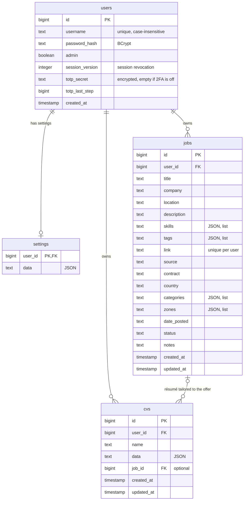

# Database map

PostgreSQL 17 database. The schema is created by Flyway from `backend/src/main/resources/db/migration/`
(`V1__init.sql`, `V2__securite_comptes.sql`).

Everything is tied to a user: deleting an account deletes its offers, résumés and settings.

## Schema

## Relationships

| From | To | Cardinality | On delete |
|---|---|---|---|
| `settings.user_id` | `users.id` | 0 or 1 row per user | settings are deleted with the account |
| `jobs.user_id` | `users.id` | many offers per user | offers are deleted with the account |
| `cvs.user_id` | `users.id` | many résumés per user | résumés are deleted with the account |
| `cvs.job_id` | `jobs.id` | a résumé can be linked to an offer | the résumé is kept, the link is cleared |

## Tables

### `users`: accounts

| Column | Type | Constraint | Role |
|---|---|---|---|
| `id` | `bigint` | primary key, auto-generated | account identifier |
| `username` | `text` | required, unique case-insensitively | login name |
| `password_hash` | `text` | required | hashed password (BCrypt), never in clear |
| `admin` | `boolean` | default `false` | can create and delete accounts |
| `session_version` | `integer` | default `0` | incremented when the password or two-factor authentication changes; a session opened with an older value is rejected |
| `totp_secret` | `text` | | two-factor secret, encrypted (AES-GCM, key `APP_SECRET_KEY`); empty when disabled |
| `totp_last_step` | `bigint` | default `0` | last accepted code, so that a code cannot be used twice |
| `created_at` | `timestamp` | default: now | creation date |

### `settings`: a user's search settings

| Column | Type | Constraint | Role |
|---|---|---|---|
| `user_id` | `bigint` | primary key, references `users.id` | owner |
| `data` | `text` | required | settings JSON |

The row only exists after the settings are first saved. Missing values come from
`backend/src/main/resources/default-settings.json`.

Content of `data`:

| Key | Type | Role |
|---|---|---|
| `locations` | list | cities, regions or countries to search in |
| `country` | text | country of the searches and default country of the offers |
| `radius_km` | integer | radius around a city |
| `results_per_search` | integer | results per site, per search and per location |
| `max_age_days` | integer | maximum age of the offers |
| `parallel_searches` | integer | searches run at the same time |
| `per_site` | integer | simultaneous searches on a single site |
| `searches` | list | exact searches, sent as they are |
| `contract` | text | contract type put in front of each keyword |
| `search_tags` | list | search keywords, each searched separately |
| `search_skills` | list | former separate list of skills to search; now merged into `search_tags` by the interface |
| `sites` | list | enabled sites (`linkedin`, `hellowork`, `indeed`, `google`) |
| `skills` | list | skills to detect in the offers |
| `categories` | object | category name → keywords |
| `serpapi_key` | text | the user's own SerpAPI key (optional); encrypted (`enc:…`), never sent back to the browser |
| `deepl_key` | text | the user's DeepL key; encrypted (`enc:…`), never sent back to the browser |

### `jobs`: offers

| Column | Type | Constraint | Role |
|---|---|---|---|
| `id` | `bigint` | primary key, auto-generated | offer identifier |
| `user_id` | `bigint` | required, references `users.id` | owner |
| `title` | `text` | required | job title |
| `company` | `text` | | company |
| `location` | `text` | | location as given by the site |
| `description` | `text` | | text of the offer |
| `skills` | `text` | default `[]` | JSON: skills detected or added by hand |
| `tags` | `text` | default `[]` | JSON: searches that found the offer |
| `link` | `text` | required, unique per user | link to the offer; `manuel:…` for an offer entered without a link |
| `source` | `text` | | originating site, or `manuel` |
| `contract` | `text` | | contract type |
| `country` | `text` | | country inferred from the location |
| `categories` | `text` | default `[]` | JSON: automatic categories |
| `zones` | `text` | default `[]` | JSON: search locations that found the offer |
| `date_posted` | `text` | | publication date given by the site |
| `status` | `text` | default `a_trier` | board column |
| `notes` | `text` | default empty | the user's notes |
| `created_at` | `timestamp` | default: now | date added |
| `updated_at` | `timestamp` | default: now | last change |

Values of `status`: `a_trier` (to sort), `interesse` (interested), `postule` (applied), `en_attente` (waiting),
`entretien` (interview), `refuse` (rejected), `pas_interesse` (not interested).

The `(user_id, link)` uniqueness constraint is used for deduplication: an offer found again by a new search keeps
its status and notes, only its tags and zones are completed. Two users can have the same offer, each with their own
status.

### `cvs`: résumés

| Column | Type | Constraint | Role |
|---|---|---|---|
| `id` | `bigint` | primary key, auto-generated | résumé identifier |
| `user_id` | `bigint` | required, references `users.id` | owner |
| `name` | `text` | required | name of the résumé in the editor |
| `data` | `text` | default `{}` | JSON: the whole content of the résumé |
| `job_id` | `bigint` | references `jobs.id` | offer the résumé was tailored to |
| `created_at` | `timestamp` | default: now | creation date |
| `updated_at` | `timestamp` | default: now | last change |

Content of `data`:

| Key | Type | Role |
|---|---|---|
| `lang`, `lang_variant` | text | language of the résumé (`fr` or `en`, variant `en-GB` / `en-US`) |
| `style` | text | `moderne`, `tech` or `classique` |
| `accent` | text | colour (`#rrggbb`) |
| `max_pages` | integer | 1 or 2 |
| `show_photo`, `photo` | boolean, text | photo as an encoded image (data URI) |
| `section_order` | list | order of the sections |
| `info` | object | first name, last name, title, email, phone, city, links, availability, profile |
| `experience` | list of objects | title, company, location, start, end, current, description |
| `projects` | list of objects | name, context, technologies, link, dates, description |
| `education` | list of objects | degree, school, location, dates, description |
| `certifications` | list of objects | name, issuer, date |
| `hard_skills` | list of objects | category and list of skills |
| `soft_skills`, `interests` | lists | short texts |
| `languages` | list of objects | language and level |

## Indexes

| Index | Table | Columns | Used for |
|---|---|---|---|
| `users_username_key` | `users` | `lower(username)`, unique | login and uniqueness of usernames |
| unique constraint | `jobs` | `(user_id, link)` | deduplication of offers |
| `jobs_user_status_idx` | `jobs` | `(user_id, status)` | loading a user's board |
| `cvs_user_idx` | `cvs` | `user_id` | list of a user's résumés |

## Design choices

- **JSON stored as `text`**: lists and objects (skills, categories, résumé content) are read and written as a whole
  by the app, and the `text` type preserves key order, which `jsonb` does not.
- **Sessions outside the database**: login sessions are kept in the server's memory; a restart requires logging in
  again.
- **Technical table**: Flyway adds `flyway_schema_history` to track applied migrations.
